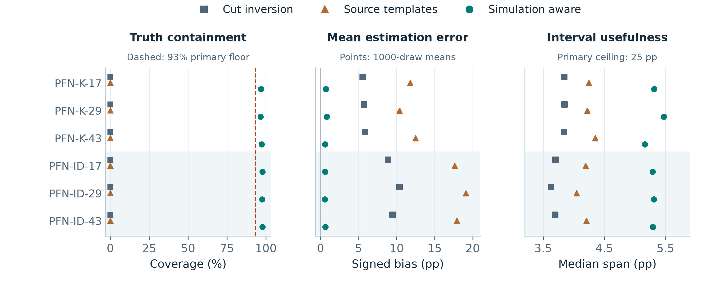

# Parallasse

**Quark–gluon jet tagging and fraction inference under Monte Carlo generator shift.**

A classifier can keep ranking jets well while its original decision threshold admits substantially more background. Parallasse measures what happens when models trained on **Pythia 8** are applied to **Herwig 7** and how that shift affects the estimated quark fraction of a mixed sample.

[Classification study](output/pdf/parallasse_report.pdf) · [Mixture replication](output/pdf/parallasse_report_v2.pdf) · [Energy Flow Network study](output/pdf/parallasse_report_v3.pdf) · [Score-template study](output/pdf/parallasse_report_v4.pdf)

## Approach

- **Tagging.** Compare XGBoost and an MLP on jet-level observables with Particle Flow Networks using constituent kinematics (PFN-K) or kinematics and particle identity (PFN-ID). Train and tune on Pythia, set each threshold at 10% Pythia calibration gluon acceptance, then freeze it for both held-out generators. A separate comparison adds an Energy Flow Network (EFN).
- **Fraction inference.** Compare counting jets above the cut, fitting Pythia score templates, and profiling a Pythia–Herwig interpolation over the full binned score distribution. The final template study reuses the frozen PFNs and keeps the modelling and evaluation jets disjoint.

## Results

Means across three training seeds on 20,000 held-out Pythia jets and 100,000 Herwig jets. Gluon acceptance uses each model's frozen Pythia threshold. [Uncertainty and contrasts](results/task0004/20261110-heldout-01/summary.json) · [Per-seed results](results/task0004/20261110-heldout-01/per_seed.csv)

| Model | Pythia ROC AUC | Herwig ROC AUC | Pythia gluon acceptance | Herwig gluon acceptance |
| --- | ---: | ---: | ---: | ---: |
| XGBoost | 0.8618 | 0.8000 | 10.84% | 19.21% |
| MLP | 0.8628 | 0.7996 | 10.64% | 18.99% |
| PFN-K | 0.8562 | 0.8013 | 10.85% | 17.88% |
| PFN-ID | **0.8683** | **0.8031** | 10.81% | 21.04% |

- **Particle identity improved ranking and increased fraction bias.** Its AUC gain shrank from +0.0122 on Pythia to +0.0018 on Herwig. On independent Herwig records with a 50% quark fraction and 10,000 jets, PFN-ID increased absolute expected fraction bias by **3.96 percentage points** relative to PFN-K (paired descriptive 95% interval [3.52, 4.45]). The EFN missed its prespecified improvement criterion. [Replication](results/task0008/20261111-replication-01/summary.json) · [EFN results](results/task0009/20261111-efn-02/summary.json)
- **Simulation-aware templates improved coverage in the primary Herwig comparison.** At the same fraction and sample size, they covered the true fraction in **96.5–97.7%** of 1,000 pseudoexperiments per checkpoint across six frozen PFNs. Both comparators had zero observed hits per checkpoint. Median interval spans were **5.16–5.47 percentage points**. Secondary conditional coverage fell to 90.9% on Pythia and 91.0% on Herwig. These results apply to the studied particle-level simulations and declared generator family. [Full evaluation grid](results/task0014/20261116-template-evaluation-01/metrics.csv)



## Quick start

From the repository root, use Python 3.12. The dependency pins were verified on macOS arm64. Run the test suite before downloading data.

```bash
python3.12 -m venv .venv
.venv/bin/python -m pip install -c requirements-lock.txt -e '.[dev]'
.venv/bin/python -m pytest -q
```

For the preprocessing smoke check, fetch and audit the two core Zenodo files (about 208 MB combined). The smoke check uses 128 Pythia training jets.

```bash
.venv/bin/python scripts/download_data.py
.venv/bin/python scripts/audit_data.py
.venv/bin/python scripts/smoke_data.py
```

The Python package is in `src/parallasse/`, with experimental configurations in `configs/` and entry points in `scripts/`. The released tables document the results. Replaying the exact historical runs requires the original local checkpoints and score archives.

## Credits

**Matteo Sgobba** · MSc student in Data Science and Engineering, Politecnico di Torino · [GitHub](https://github.com/matteosgobba) · [LinkedIn](https://www.linkedin.com/in/matteosgobba/)

Independent student research project. The study uses public CC BY 4.0 jet samples from [Komiske, Metodiev, and Thaler (Pythia)](https://doi.org/10.5281/zenodo.3164691) and [Pathak, Komiske, Metodiev, and Schwartz (Herwig)](https://doi.org/10.5281/zenodo.3066475). The particle-based models follow [Energy Flow Networks](https://arxiv.org/abs/1810.05165).
